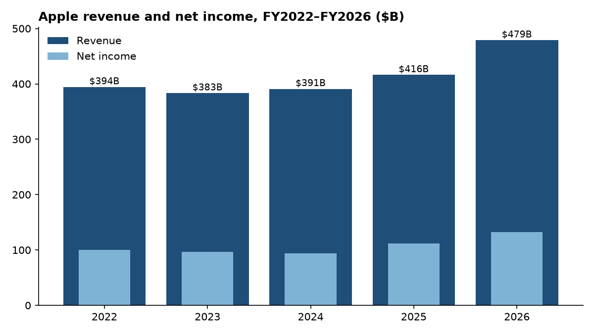
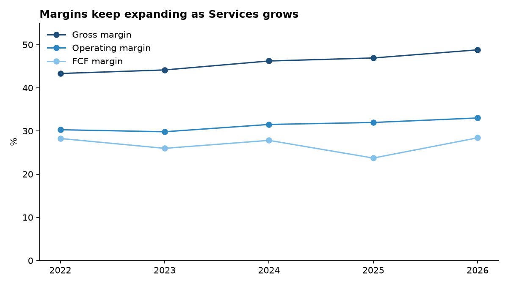
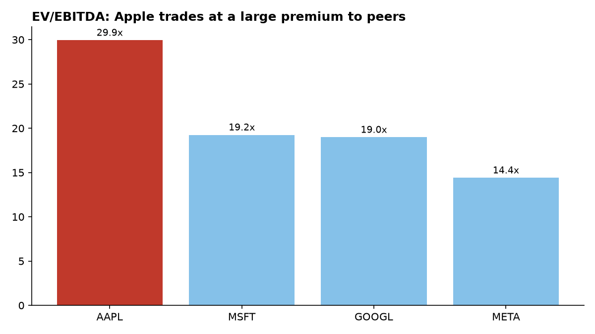
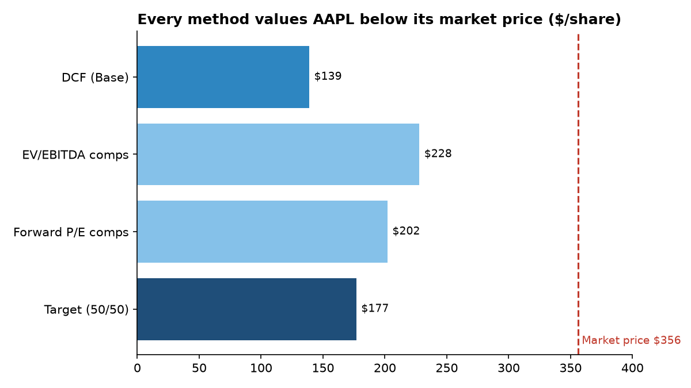
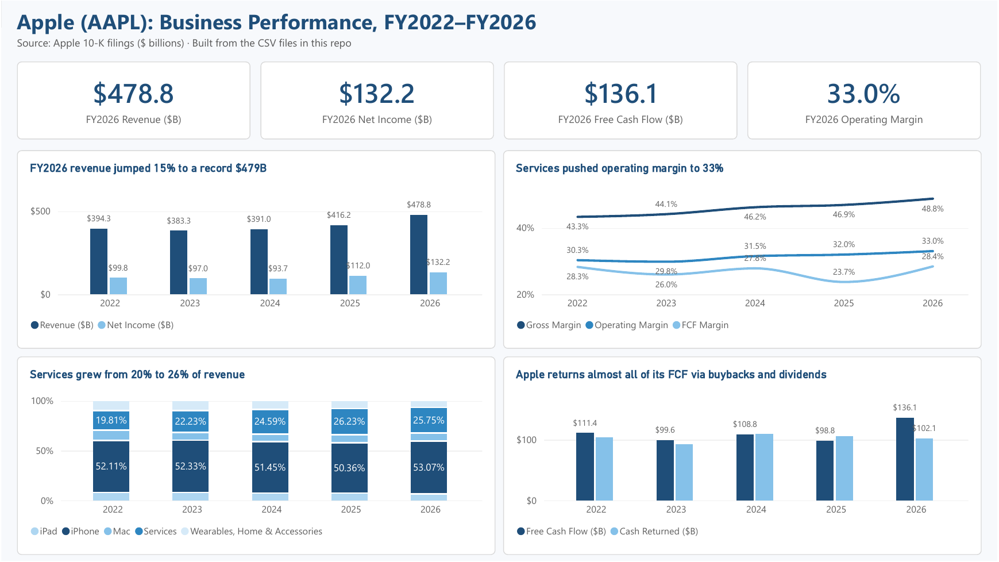
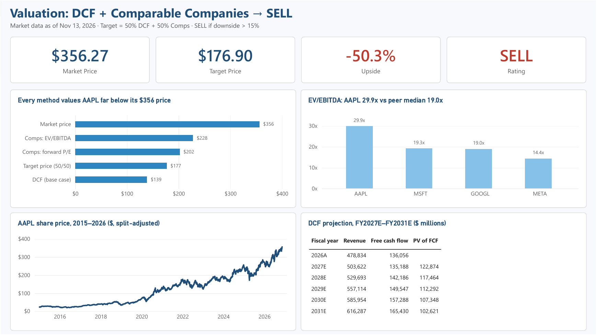

# Apple Inc. (AAPL) – Equity Valuation Project

**Python · SQL (MySQL) · Excel · Power BI** | Data as of **November 13, 2026** | Author: **Dinh Cong Thanh**, Finance & Data Analytics, Ball State University

> **Rating: SELL** · Target price **$176.90** vs market price **$356.27** (**–50.3%**)
> Apple is a great business – record revenue and free cash flow in FY2026 – but at 29.9x EV/EBITDA the stock already prices in growth far above anything Apple has delivered.

---

## 1. Project goal

Act like an equity research analyst: collect Apple's data, analyze its financial statements, value the company with two methods (**DCF** and **Comparable Companies**), and give a Buy / Hold / Sell recommendation.

| Step | Tool | Output |
|---|---|---|
| Data collection & cleaning | Python (`yfinance`, `pandas`) | `notebooks/01_data_collection.ipynb` |
| Storage & analysis | MySQL | `sql/01` – `sql/07` |
| Beta, Cost of Equity, WACC | Python | `notebooks/02_beta_wacc.ipynb` |
| DCF, Sensitivity, Comps | Excel | `excel/AAPL_DCF_Model.xlsx` |
| Model check & charts | Python | `notebooks/03_dcf_comps_charts.ipynb` |
| Dashboard | Power BI | `powerbi/AAPL_Dashboard.pbix` |

## 2. Repository structure

```
aapl-equity-research/
├── data/                      # Clean 10-K data FY2022–FY2026 ($ millions) + peer multiples
├── notebooks/
│   ├── 01_data_collection.ipynb   # yfinance → checks → CSV → MySQL
│   ├── 02_beta_wacc.ipynb         # Beta, CAPM, WACC
│   └── 03_dcf_comps_charts.ipynb  # DCF check, reverse DCF, comps, charts (runs offline)
├── sql/                       # 7 analysis scripts (CTE, LAG, CASE WHEN, JOIN, window functions)
├── excel/AAPL_DCF_Model.xlsx  # Cover · Assumptions · Historical Data · DCF · Sensitivity · Comps · Summary
├── powerbi/                   # AAPL_Dashboard.pbix (+ .pbip text version), guide, model output tables
└── images/                    # Charts used in this README
```

## 3. Business performance (FY2022–FY2026)



| $ billions | FY2022 | FY2023 | FY2024 | FY2025 | FY2026 |
|---|---|---|---|---|---|
| Revenue | 394.3 | 383.3 | 391.0 | 416.2 | **478.8** |
| Revenue growth | – | (2.8%) | 2.0% | 6.4% | **15.1%** |
| Operating margin | 30.3% | 29.8% | 31.5% | 32.0% | **33.0%** |
| Net income | 99.8 | 97.0 | 93.7 | 112.0 | **132.2** |
| Free cash flow | 111.4 | 99.6 | 108.8 | 98.8 | **136.1** |
| Diluted EPS ($) | 6.11 | 6.13 | 6.08 | 7.46 | **8.98** |

Key findings from the SQL analysis:

- **Services is the margin engine.** Services grew from 19.8% to 25.8% of revenue and earns a ~76% gross margin vs ~39% for products. That is why gross margin rose every year, from 43.3% to 48.8% (`sql/03`, `sql/06`).
- **FY2026 was an iPhone super-cycle:** iPhone revenue +21.2% to $254.1B (`sql/06`).
- **Buybacks boost EPS.** Diluted shares fell from 16.3B to 14.7B, so EPS grew faster than net income (`sql/02`). Apple returned 75–108% of its FCF to shareholders each year (`sql/05`).
- **Liquidity needs context.** The current ratio rose from 0.88x in FY2022 to 1.02x in FY2026; the FY2026 quick ratio was 0.94x. Cash, securities, operating cash generation, and payment timing also matter, so a fixed "1.5x = healthy" rule is insufficient (`sql/04`).



## 4. Cost of capital

| Input | Value | Source |
|---|---|---|
| Beta | 1.177 | Own calculation, daily returns vs S&P 500, Jan 2015 – Nov 13 2026 |
| Risk-free rate | 4.94% | 10-year Treasury, Nov 1 2026 (Damodaran) |
| Equity risk premium | 4.41% | Implied S&P 500 ERP, Nov 1 2026 (Damodaran) |
| **Cost of equity** | **10.13%** | CAPM |
| After-tax cost of debt | 2.94% | FY2023 interest / debt × (1 – 17.0% tax) |
| Weights (E / D) | 98.5% / 1.5% | Market cap $5.18T vs debt $80.1B |
| **WACC** | **10.02%** | |

## 5. DCF valuation (Base case)

- Revenue grows at the **4-year historical average (5.2%)** for FY2027–FY2031
- FCF margin = **5-year historical average (26.8%)**
- Terminal growth **2.5%**, discounted at **10.02%**

| | $ millions |
|---|---|
| PV of FCF 2027E–2031E | 562,600 |
| PV of terminal value | 1,398,579 (71% of EV) |
| Enterprise value | 1,961,180 |
| + Cash & securities – Debt | +56,824 |
| **Equity value** | **2,018,004** |
| **Value per share** | **$138.86** |

**Sensitivity:** across WACC 8–12% and terminal growth 1.5–3.5%, value ranges from **$103 to $223** – never close to $356.

**Reverse DCF:** to justify $356, revenue must grow about **30% a year for 5 years** – roughly 6x Apple's historical average.

## 6. Comparable companies



| | AAPL | MSFT | GOOGL | META | Peer median |
|---|---|---|---|---|---|
| EV/EBITDA | 29.9x | 19.3x | 19.0x | 14.4x | **19.0x** |
| Forward P/E | 37.8x | 25.2x | 21.5x | 19.5x | **21.5x** |
| Operating margin | 33.0% | 47.1% | 33.3% | 37.8% | |

Apple trades at a **~58% EV/EBITDA premium** even though MSFT and META have higher margins.
Implied value: **$227.81** (EV/EBITDA) and **$202.06** (forward P/E) → Comps value **$214.94**.

## 7. Recommendation



| Method | Value / share | Weight |
|---|---|---|
| DCF (Base) | $138.86 | 50% |
| Comps (average) | $214.94 | 50% |
| **Target price** | **$176.90** | |
| Current price | $356.27 | |
| **Upside / (downside)** | **–50.3% → SELL** | |

**Investment thesis**
1. **Quality is not the question.** Record revenue, a growing high-margin Services business and $136B of FCF make Apple one of the strongest companies in the world.
2. **Price is the question.** The market is paying ~40x earnings for a company that has grown revenue ~5% a year over the last four years.
3. **What would change my view:** sustained double-digit revenue growth (e.g. AI-driven upgrade cycles), Services above 30% of revenue, or a price pullback toward the $200–230 comps range.

**Risks to a SELL call:** Apple has kept a premium valuation for years; another strong iPhone cycle or AI monetization could keep the stock expensive for a long time.

## 8. Power BI dashboard

Two pages built from the same CSV files (`powerbi/AAPL_Dashboard.pbix`):





## 9. Limitations

- The model uses operating cash flow less capex as a simplified FCF proxy and discounts it at WACC. This is not a fully reconstructed unlevered FCFF model; refining interest, taxes, working capital, and non-operating assets is a next step.
- SQL 07 uses October–September as an approximation for Apple's 52/53-week fiscal years. Its historical P/E proxy uses dividend-adjusted prices and full-year EPS, not point-in-time investable P/E. The annual price-change query measures first-to-last observed trading day; 2026 is partial-year.
- The DCF holds the share count flat, but Apple buys back ~1.6% of its shares per year, which raises value per share over time.
- Interest expense is not disclosed after FY2023, so cost of debt uses FY2023 (debt is only 1.5% of capital, so WACC barely changes).
- Simple-average growth mixes a weak year (FY2023) and a super-cycle year (FY2026).
- Peer multiples are a snapshot from one day (Nov 13, 2026).
- This is a student project for learning purposes, not investment advice.

## 10. How to run

```bash
conda create -n stock_project python=3.11 -y
conda activate stock_project
pip install -r requirements.txt
```

1. In MySQL Workbench, create the schema `aapl_stock_project` and a user with access to it
2. Run `notebooks/01_data_collection.ipynb` (asks for the MySQL password – it is never saved in the file)
3. Run the scripts in `sql/` in order
4. Run `notebooks/02_beta_wacc.ipynb` and `notebooks/03_dcf_comps_charts.ipynb`
5. Open `excel/AAPL_DCF_Model.xlsx` – change the yellow cells on **Assumptions** to test your own scenario
6. Open `powerbi/AAPL_Dashboard.pbix` → **Transform data → Edit parameters** → set `ProjectFolder` to your copy of the repo → **Refresh** (details in `powerbi/PowerBI_Guide.md`)

### Reproduce the saved snapshot

The four `data/raw/*.csv` files are included so the November 13, 2026 snapshot can be reproduced without downloading a newer market series. Notebook 01 defaults to these saved inputs; live downloads are opt-in. Notebook 02 also uses the saved price series.

To load the five project tables and run every SQL file from the repository root:

```bash
python scripts/validate_mysql.py --load
```

The command prompts for the MySQL password. Existing tables are kept under timestamped backup names before the new tables are swapped in. Use the command without `--load` to validate existing tables against the saved CSVs. Create `aapl_stock_project` and grant your local project user access before running it.

Validation on November 15, 2026: **7/7 SQL scripts passed** on MySQL 8.0.44; all five tables matched their CSVs, including **14,925 daily price rows across five tickers**. Balance-sheet, cash-flow, and product-revenue reconciliation checks passed. See [validation report](validation/README.md) and [saved query results](validation/sql_results/).

## Sources
- Apple Inc. Form 10-K, FY2026 (fiscal year ended Sep 26, 2026) and prior years – [SEC EDGAR](https://www.sec.gov/Archives/edgar/data/320193/000032019326000026/aapl-20260926.htm)
- Share prices and peer multiples (Nov 13, 2026 close) – [StockAnalysis.com](https://stockanalysis.com/stocks/msft/statistics)
- Risk-free rate and equity risk premium – [Aswath Damodaran, NYU Stern](https://pages.stern.nyu.edu/~adamodar/New_Home_Page/home.htm)
